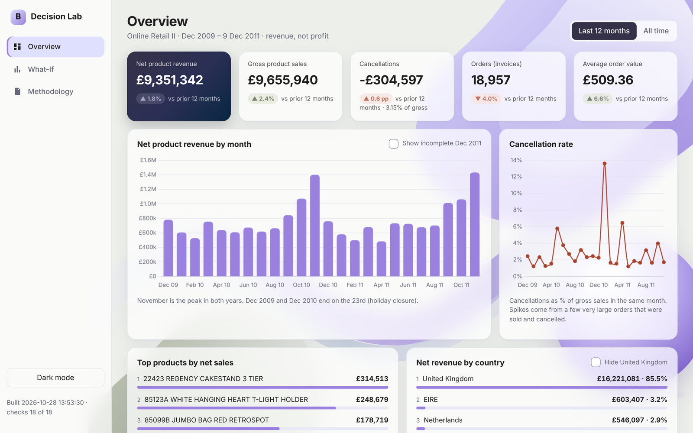
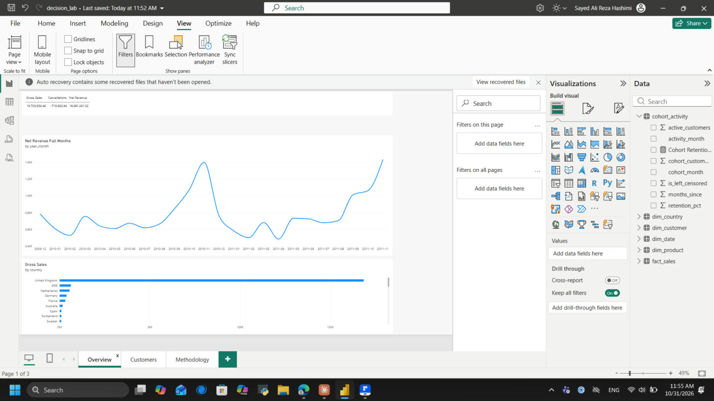
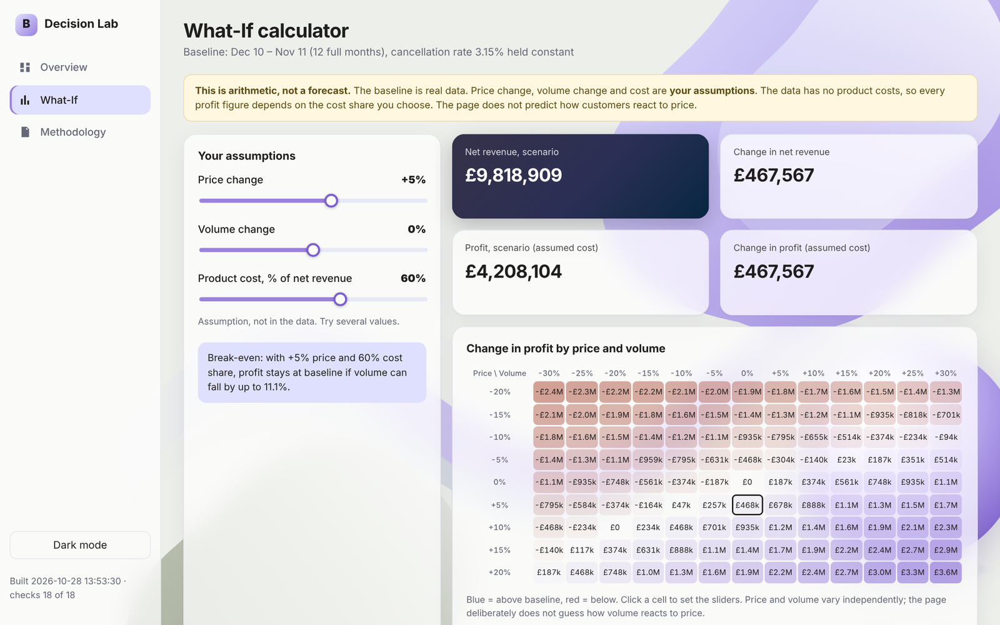
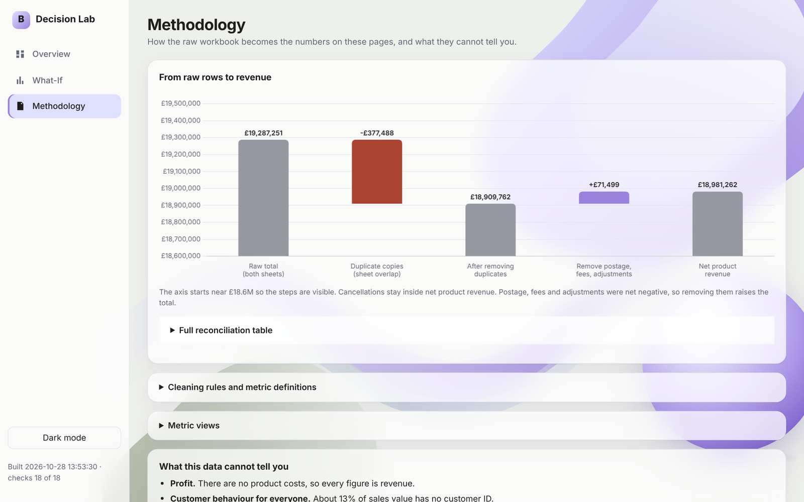

# Business Performance & Decision Lab

A business-intelligence project on two years of real retail transactions
(Online Retail II). The focus is **numbers you can trust**: a reproducible
pipeline that reconciles to the penny, documented cleaning rules, SQL metric
views, and a dashboard that states what the data can and cannot say.

**[Live demo](https://seraphcodes.github.io/business-performance-decision-lab/)** · Stack: Python, pandas, SQLite, Streamlit, Plotly, JavaScript, pytest.

## Why this project

Most student dashboards start with charts. This one starts with a question: *can
I trust the number?* The raw workbook double-counts £377,488.45 because its two
sheets overlap, and a few huge orders that were sold and then cancelled would
have put the wrong products at the top of a naive ranking. I wanted a project
where every pound is accounted for, every cleaning rule is written down with
evidence, and the dashboard says plainly what the data cannot tell you (for
example: there are no product costs, so there is no real profit).

**Status:** core release done and live: data pipeline, metric views, Overview,
Methodology and a narrow What-If Simulator, as a Streamlit app and a public
static website. Planned next: customer analytics (cohorts, RFM).

## What it does

1. **Builds a database from the raw Excel workbook** (`python -m src.build_db`).
   Every one of the 1,067,371 original rows is kept and labelled; none are deleted.
2. **Reconciles** from the raw total (£19,287,250.57) to net product revenue
   (£18,981,261.52). The build refuses to write the database if rows or pounds
   do not add up or do not match the diagnostic baseline.
3. **Defines metrics in SQL views** (`sql/views.sql`), checked against the
   reconciliation at build time.
4. **Shows them in a Streamlit app**: Overview (trends, cancellations, products,
   countries), Methodology (the reconciliation chart, rules, limits) and a
   What-If Simulator.
5. **What-If Simulator**: a scenario calculator on a real 12-month baseline. Price
   change, volume change and cost share are the user's inputs. It shows revenue
   effect, break-even volume and a sensitivity grid. It is arithmetic, not a
   forecast: the data has no product costs, so profit exists only through the cost
   share the user enters, and it does not model how volume reacts to price.

## Web frontend (static site)

`web/` is a separate, dependency-free website (HTML, CSS, JavaScript; Chart.js is
included in `web/vendor/`). It has the same three pages as the Streamlit app, a
light/dark theme and a phone layout. It only displays `web/data/metrics.js`, an
export of the reconciled SQL views, so its numbers are the numbers the build
already checked.

- Refresh the data after a build: `.\.venv\Scripts\python.exe -m src.export_web`
  (refuses to write if the views no longer tie to the reconciliation bridge).
- View it: open `web/index.html` in a browser (no server needed).
- The what-if arithmetic in `web/js/scenario.js` is a port of `src/scenario.py`;
  `tests/test_web_scenario.py` runs both on 140 combinations and requires identical results
  (needs Node.js; skipped if it is not installed).
- Published on GitHub Pages by `.github/workflows/pages.yml` on every push to `main` that changes `web/` (the tests run first)
  (repository Settings > Pages > Source: **GitHub Actions**). The live site is
  https://seraphcodes.github.io/business-performance-decision-lab/

## Power BI report

The same reconciled data is also available as a Power BI report (3 pages: Overview,
Customers, Methodology). `python -m src.export_powerbi` writes a star schema to
`data/processed/powerbi/` and refuses to write if it does not tie to the
reconciliation bridge. The DAX measures are in `docs/powerbi/measures.dax` and the
steps to rebuild it are in `docs/powerbi/build_guide.md`.

- Report file: `docs/powerbi/decision_lab.pbix` (open with free Power BI Desktop, Windows)
- PDF: `docs/powerbi/report.pdf`
- Static preview on the website: the **Power BI** page
- Limit: the model has no product relationship (stock codes that differ only by
  upper/lower case collide), so product visuals can differ slightly from the website.

## Screenshots

**What-If calculator** (arithmetic on a real 12-month baseline, not a forecast)

**Methodology: from raw rows to net revenue**

## Findings

- **The raw total double-counts £377,488.45.** The workbook's two sheets overlap
  for 1-9 Dec 2010; all 22,523 rows in that window appear twice. Removing the
  copies gives £18,909,762.12.
- **Net product revenue is £18,981,261.52** (gross sales £19,700,954.46 minus
  cancellations £719,692.94). Postage, fees and adjustments are kept apart from
  product revenue.
- **November is the peak** in both years (about £1.40M in 2010 and £1.43M in 2011).
- **Cancellation spikes come from a few huge orders** that were sold and cancelled
  (for example stock code 23843, about £168k, in Dec 2011), so products are ranked
  by net sales, not gross.
- **The UK is the large majority of revenue** (about £16.2M net of £19.0M).

## Limitations (read before quoting a number)

- Revenue, **not profit**: the data has no product costs.
- 22.8% of rows have no Customer ID (13.1% of sales value), so customer-level
  analysis covers about 87% of sales.
- Credit notes cannot be linked to the original sale, so cancellation rates are
  by month, not by order.
- December 2011 contains only 9 days and is hidden from trend charts by default.
- Some cleaning choices are judgement calls (stock adjustments, repeated identical
  lines, postage as separate income). Each is listed with evidence in
  `docs/cleaning_rules.md`.

## How to run

Run every command from the project folder, using the project's own virtual
environment (Windows PowerShell shown).

1. Install the pinned dependencies once:
   `.\.venv\Scripts\python.exe -m pip install -r requirements.txt`
2. Put the UCI workbook at `data/raw/online_retail_II.xlsx` (it is not committed).
3. Run the tests (they need no data): `.\.venv\Scripts\python.exe -m pytest`
4. Build the database (a few minutes, needs roughly 1 GB free disk):
   `.\.venv\Scripts\python.exe -m src.build_db`
5. Optional text report of the headline numbers:
   `.\.venv\Scripts\python.exe -m src.metrics`
6. Start the app: `.\.venv\Scripts\python.exe -m streamlit run app.py`

## Project layout

- `src/` pipeline: `load`, `classify`, `reconcile`, `build_db`, `metrics`, `scenario`
- `sql/views.sql` metric definitions
- `pages/` Streamlit pages; `app.py` landing page
- `web/` static website; `src/export_web.py` creates its data file
- `tests/` hand-calculated fixtures; the rules were also checked by deliberately
  breaking the code (all breaks caught). A test also keeps the figures quoted in the README
  and docs equal to the verified export, so a document cannot drift from the build
- `docs/` cleaning rules, metric definitions, diagnostic evidence

## Licence

Code: MIT (see `LICENSE`). The dataset has its own licence, see below.

## Dataset and attribution

Chen, D. (2012). *Online Retail II* [Dataset]. UCI Machine Learning Repository.
https://doi.org/10.24432/C5CG6D. Licence: CC BY 4.0
(https://archive.ics.uci.edu/dataset/502/online+retail+ii).

Changes made: cleaned, labelled and loaded into SQLite (see the Methodology page
and `docs/cleaning_rules.md`). This project is not affiliated with or endorsed by
the dataset's authors.
